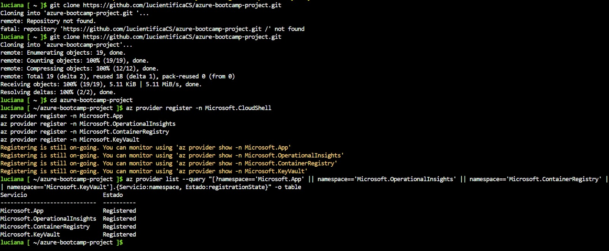
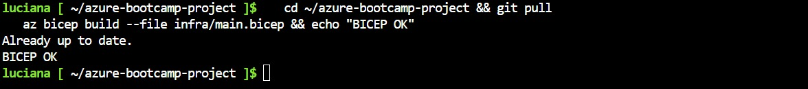
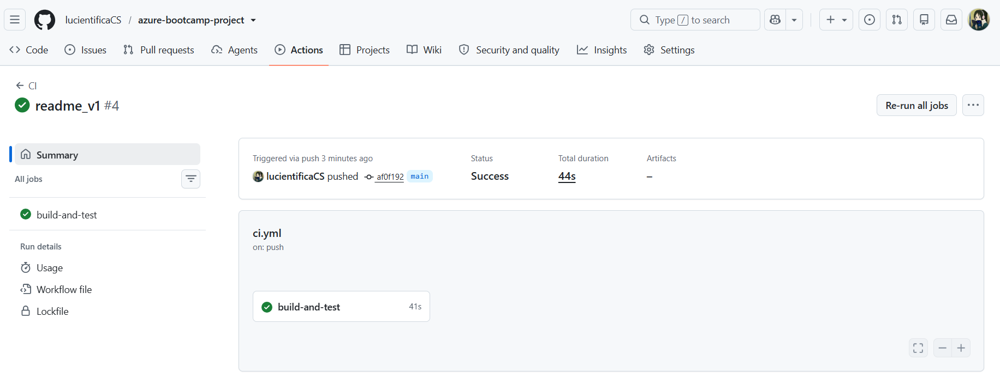

# Proyecto Final: Bootcamp Azure (LEAD UTP) ☁️

Este proyecto consiste en una aplicación web desarrollada con Python (Flask), empaquetada en un contenedor Docker y desplegada sobre servicios de Azure.

El objetivo fue integrar la mayor cantidad posible de conceptos vistos durante el programa: infraestructura como código con Bicep, almacenamiento seguro de secretos mediante Key Vault, control de accesos con Managed Identity y RBAC, conectividad privada mediante redes virtuales y automatización de despliegues utilizando GitHub Actions.


## Arquitectura de la Solución

```text
GitHub (código)
      │
      ├── CI/CD (pruebas, validación Bicep, build Docker)
      ▼
Azure Container Registry (ACR)
      │
      │  AcrPull (Managed Identity)
      ▼
Azure App Service (Linux Container)
      │
      ├── Key Vault (demo-secret)
      │       └── Secrets User
      │
      └── Storage Account
              └── Blob Data Reader

Red Virtual (10.0.0.0/16)
├── Subredes separadas
└── NSG con acceso restringido

Monitoreo
├── Application Insights
└── Log Analytics Workspace
```

## Estructura del Repositorio

```text
.
├── app/
│   ├── Código fuente Flask
│   ├── Dockerfile
│   └── Scripts de prueba
│
├── infra/
│   └── main.bicep
│
├── .github/
│   └── workflows/
│       └── ci.yml
│
└── capturas/
    └── Evidencias del despliegue
```


##  Guía de Despliegue

### 1. Iniciar sesión en Azure

```bash
az login
```

### 2. Crear el grupo de recursos

```bash
az group create \
  -n rg-retailandes-dev \
  -l qatarcentral \
  --tags project=bootcamp-azure env=dev
```

### 3. Desplegar la infraestructura base

```bash
az deployment group create \
  -g rg-retailandes-dev \
  -f infra/main.bicep \
  -n main \
  -p demoSecretValue='valor-secreto-de-prueba'
```

### 4. Construir la imagen Docker en Azure Container Registry

```bash
ACR=$(az deployment group show \
  -g rg-retailandes-dev \
  -n main \
  --query properties.outputs.acrName.value \
  -o tsv)

az acr build \
  -r $ACR \
  -t retail-app:v1 \
  ./app
```

### 5. Actualizar App Service con la nueva imagen

```bash
az deployment group create \
  -g rg-retailandes-dev \
  -f infra/main.bicep \
  -n main \
  -p demoSecretValue='valor-secreto-de-prueba' \
  deployWebApp=true
```

### 6. Verificar el funcionamiento

```bash
URL=$(az deployment group show \
  -g rg-retailandes-dev \
  -n main \
  --query properties.outputs.webUrl.value \
  -o tsv)

curl $URL/health
curl $URL/secret-check
```

---

##  Eliminación de Recursos

Para evitar consumir créditos innecesariamente, todos los recursos pueden eliminarse con un único comando:

```bash
az group delete \
  -n rg-retailandes-dev \
  --yes \
  --no-wait
```

## Evidencias

Para el certificado del bootcamp, presento las siguientes evidencias del flujo de trabajo y configuración del proyecto:

**1. Preparación del Entorno (Azure Cloud Shell)**



**2. Validación de Infraestructura (Bicep)**



**3. Integración Continua (CI en GitHub Actions)**

